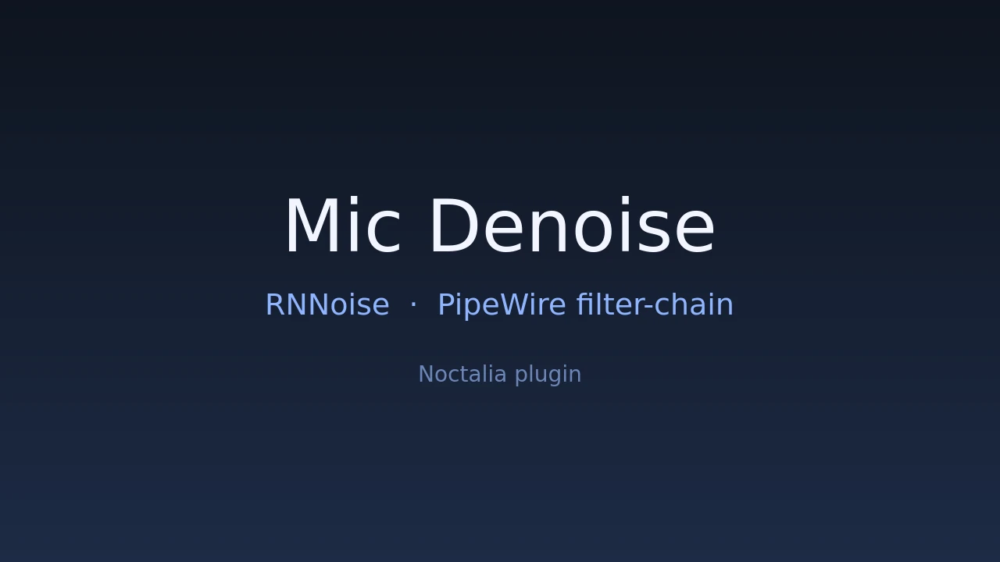

# Noctalia Mic Denoise — RNNoise microphone noise suppression for PipeWire (Noctalia v5 plugin)

A [Noctalia](https://noctalia.dev) v5 plugin that turns real-time **RNNoise microphone noise
suppression** on and off from the control-center tile, the optional bar widget, or a keybind.
It works by switching the PipeWire **default source** between the raw microphone and a virtual
`filter-chain` source, so when denoising is off nothing consumes the chain and PipeWire suspends
it — no DSP work, no CPU cost, no battery drain.



```sh
pactl list short sources | grep rnnoise    # the virtual source is live
```

## Features

- **One-click toggle** in the control center (and an optional bar widget) for RNNoise denoising
- **Zero CPU when off**: the filter-chain has no consumer, so PipeWire suspends the whole graph
- **No feedback loops**: the capture side is pinned to the physical microphone when the config is
  generated, so pointing the default source at the virtual one can never create a loop
- **Automatic microphone choice**: falls back to the last used input, or the first available one
- **Existing recordings follow you**: every capture stream is moved along when the default source
  changes, so apps keep working mid-call
- CLI-independent: everything is `pactl` + one generated PipeWire snippet, no daemon to babysit

## Requirements

| Requirement | Why |
| --- | --- |
| `pipewire` (≥ 1.0) | Carries the filter-chain that runs RNNoise. |
| `noise-suppression-for-voice` | Provides `librnnoise_ladspa.so`, the LADSPA plugin the chain loads. |
| `libpulse` (`pactl`) | Switches the default source and moves capture streams. |
| Noctalia v5 | Provides the control-center tile and the plugin runtime. |

Arch / CachyOS:

```sh
sudo pacman -S pipewire noise-suppression-for-voice libpulse
```

## Install

**The easiest way is the Noctalia plugin store**: Settings -> Plugins -> Store -> search
*Mic Denoise* -> install (only `noise-suppression-for-voice` has to be installed first). The
instructions below are for a source checkout.

```sh
git clone https://github.com/Goldppx/noctalia-mic-denoise.git
cd noctalia-mic-denoise
./install.sh            # register the source + enable the plugin (no root needed)
./install.sh --restart  # also restart PipeWire if the virtual source is not loaded yet
```

`install.sh` is idempotent: it checks `noctalia`/`pactl`/`pw-cli`, warns when
`librnnoise_ladspa.so` is missing, registers this checkout as a plugin source, enables
`goldesquemoon/mic-denoise`, waits for the generated PipeWire snippet and reports whether the
virtual source is live.

Manual install:

```sh
noctalia msg plugins source add my-plugins path /path/to/noctalia-mic-denoise
noctalia msg plugins enable goldesquemoon/mic-denoise
```

Then add the tile under **Settings → Control center → Shortcuts → Mic Denoise**, or in
`~/.config/noctalia/config.toml`:

```toml
[[control_center.shortcuts]]
type = "goldesquemoon/mic-denoise:denoise"
```

## Usage

| Entry | Type | What it does |
| --- | --- | --- |
| `denoise` | control-center shortcut | Toggles denoising; highlighted means on. Right click opens the audio control-center tab. |
| `mic-denoise` | bar widget | Same state and toggle from the bar; the tooltip shows the current input. |
| `state` | service | Owns the logic, polls `pactl`, publishes state for the two clients above. |

Keybind example (niri):

```kdl
Mod+Shift+M { spawn "noctalia" "msg" "plugin" "goldesquemoon/mic-denoise:state" "all" "toggle"; }
```

Command line:

```sh
noctalia msg plugin goldesquemoon/mic-denoise:state all toggle
pactl get-default-source
```

## Settings

| Setting | Type | Default | Description |
| --- | --- | --- | --- |
| `hardware_source` | `string` | empty | Microphone to switch back to when denoising is off. Empty reuses the last one, or picks the first available input. |
| `source` | `string` | `rnnoise_source` | Name of the virtual source created by the generated filter-chain config. |
| `poll_interval` | `int` | `5000` | How often the tile and widget re-read the state, in milliseconds (minimum 500). Toggles refresh immediately; the tick only catches changes made elsewhere. |

Denoising strength lives in the generated snippet
`~/.config/pipewire/pipewire.conf.d/50-mic-denoise.conf`: raise or lower
`VAD Threshold (%)` (default 87) and restart PipeWire.

## How it works

```
physical microphone ──► filter-chain (RNNoise) ──► virtual source "Mic Denoise (RNNoise)"
                              ▲
                              └── consumed only while it is the default source;
                                  otherwise the whole graph is suspended
```

The service publishes status through the plugin state, the tile and widget are thin clients, and
the only privileged-free action it takes is `pactl set-default-source` plus
`pactl move-source-output` for open streams.

## FAQ

**Does it add latency?** The chain runs with a 1024-sample buffer at 48 kHz (about 21 ms). Keep it
if you notice echo; the value is in the generated snippet.

**Does changing the microphone interrupt my call?** Normally not: the plugin repoints the
filter-chain's live capture stream, so the switch is seamless. PipeWire is only restarted when
that stream cannot be moved.

**The tile is greyed out and I get a notification.** That is the readiness hint: either
`librnnoise_ladspa.so` is missing (install `noise-suppression-for-voice`) or the filter-chain has
not been loaded yet (restart PipeWire).

**Is my microphone still being processed when denoising is off?** No. With denoising off the
virtual source has no consumer, PipeWire suspends the filter-chain, and the raw microphone is the
default source again.

**Does it work with Bluetooth headsets and USB microphones?** Yes — any PipeWire source works. Set
`hardware_source` to the device you want to fall back to.

**The tile is greyed out.** The virtual source does not exist yet: reload PipeWire with
`systemctl --user restart pipewire.service pipewire-pulse.service wireplumber.service`.

**Will it fight other tools that change the default source?** Some apps re-select their own input.
The plugin moves existing streams, but a program that hard-codes the raw device afterwards wins —
that is expected.

## 中文说明

RNNoise 实时麦克风降噪的 Noctalia v5 插件：控制中心磁贴 / 栏挂件 / 键位一键开关。

- 关闭时把默认源切回物理麦克风并把所有录音流搬回去，降噪链路没有任何消费者，
  PipeWire 直接挂起整条 graph —— **零 DSP 开销**
- 首次运行自动生成 `~/.config/pipewire/pipewire.conf.d/50-mic-denoise.conf`，把采集端钉在当时的
  物理麦克风上，避免改默认源时形成回环
- 设置项：`hardware_source`（关闭时切回的麦克风，留空自动）、`source`（虚拟源名称）、
  `poll_interval`（刷新间隔）
- 需要 `pipewire`、`noise-suppression-for-voice`、`libpulse`

安装：

```sh
git clone https://github.com/Goldppx/noctalia-mic-denoise.git
cd noctalia-mic-denoise
./install.sh --restart
```

## Search terms / 关键词

Noctalia plugin, Noctalia v5, RNNoise, microphone noise suppression, noise gate, background noise
removal, PipeWire filter-chain, LADSPA, noise-suppression-for-voice, pactl, default source,
Wayland, Niri, Hyprland, Sway, Arch Linux, CachyOS, 麦克风降噪, 实时降噪, 噪声抑制, 控制中心磁贴, 栏挂件

## Links

- Plugin source: [`mic-denoise/`](mic-denoise/)
- Noctalia: <https://noctalia.dev>
- Community plugin store: <https://noctalia.dev/plugins>

## License

MIT
